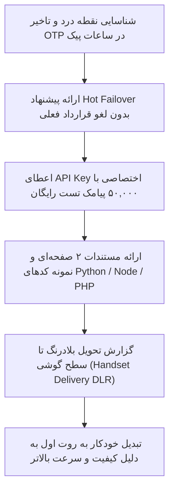

# پرشیا فاوا (فِرِستا) | مستندات گیت‌وی پیامک و اتاق جنگ توسعه بازار سازمانی
# PFG-Feresta Enterprise SMS Gateway & B2B War Room

> **مخزن حاکمیتی، مستندات وب‌سرویس مخابراتی، دانشنامه جامع ۲۰ حساب هدف و معماری اتاق جنگ فروش سازمانی**  
> **نسخه حاکمیتی:** ۲.۰ (تثبیت‌شده در ۲۴ آبان ۱۴۰۵ / 2026-11-15)  
> **محیط زنده استقرار:** سرور لایو استکهلم بر روی پورت `8085` (`http://109.120.131.224:8085/`)  
> **کانال عملیاتی تلگرام:** اختصاصی `PFG B2B Command Hall` (تفکیک کامل از زیرساخت تلیر)

---

## 📑 فهرست راهنما و دسترسی سریع (Table of Contents)

1. [دانشنامه حاکمیتی و اصول بنیادین (First Principles)](#۱-دانشنامه-حاکمیتی-و-اصول-بنیادین-first-principles)
2. [ماتریکس رسمی و ممیزی‌شده ۲۰ حساب هدف (The 20 Target Accounts)](#۲-ماتریکس-رسمی-و-ممیزی‌شده-۲۰-حساب-هدف)
3. [استراتژی نفوذ نرم و سناریوی Hot Failover](#۳-استراتژی-نفوذ-نرم-و-سناریوی-hot-failover)
4. [نقشه کامل صفحات سامانه وب اتاق جنگ (War Room Site Map)](#۴-نقشه-کامل-صفحات-سامانه-وب-اتاق-جنگ-war-room-site-map)
5. [مستندات فنی وب‌سرویس پیامک سازمانی (API Specifications)](#۵-مستندات-فنی-وبسرویس-پیامک-سازمانی)
6. [خط لوله استقرار و مدیریت فایل‌ها (Deployment & Operations)](#۶-خط-لوله-استقرار-و-مدیریت-فایلها)
7. [انطباق امنیتی، پرهیز از هاردکد و فایروال تلگرام (Security & Zero Hardcoding)](#۷-انطباق-امنیتی-پرهیز-از-هاردکد-و-فایروال-تلگرام)

---

## ۱. دانشنامه حاکمیتی و اصول بنیادین (First Principles)

برای جلوگیری از هرگونه انحراف استراتژیک، فراموشی تعاریف، جایگزینی غیرمجاز شرکت‌ها یا اتکا به حافظه ناپایدار چت، تمام اصول در مستند حاکمیتی **[docs/B2B_WARROOM_SOVEREIGN_CYCLOPEDIA.md](docs/B2B_WARROOM_SOVEREIGN_CYCLOPEDIA.md)** و راهنمای اتاق جنگ **[warroom/README.md](warroom/README.md)** مکتوب و قفل شده است.

### مأموریت کلان پرشیا فاوا (فِرِستا)
پرشیا فاوا با اتصال مستقیم بالادستی مخابراتی (SMPP مستقیم به همراه اول، ایرانسل و رایتل)، وظیفه دارد ترافیک پیامک‌های حیاتی و تراکنشی (OTP، تاییدیه لاگین، تراکنش‌های مالی، بارنامه‌ها و هشدارهای امنیتی) را از تجمیع‌کنندگان واسط و سنتی (نظیر کاوه‌نگار، مدیانا و مگفا) جذب کند.

### ممیزی ۵ پارامتری گزینش حساب‌ها (The 5-Parameter Qualification Heuristic)
هیچ حسابی بدون احراز این ۵ پارامتر وارد ماتریکس فروش نمی‌شود:
1. **شکایات علنی تاخیر OTP (اسب تروجان فنی):** احراز مستند حداقل ۲ مورد شکایت کاربران از تاخیر پیامک در ساعات اوج بازار.
2. **گردش مالی بالا و رشد تهاجمی:** بازارهای آنلاین طلا، سامانه‌های لجستیک و باربری سنگین، پلتفرم‌های لندتک و سیستم‌های ERP سازمانی.
3. **شدت و نیاز حیاتی به پیامک تراکنشی:** سهم پیامک‌های تراکنشی و بلادرنگ بیش از ۸۵٪ کل پیامک‌ها.
4. **بکر بودن حساب و شاخص نفوذ پایین رقیب (Low IEI):** پرهیز از شرکت‌های Vanity با تخفیف منفی و تمرکز بر سازمان‌های چابک و با بازدهی بالا.
5. **ضریب دسترسی سازمانی:** امکان دسترسی مستقیم به C-Level و لیدهای فنی لایه دوم از طریق پروفایل‌های معتبر.

### قانون شماره ۱ حاکمیتی: لینکدین شخصی معتبر (Rule #1: Verified Personal LinkedIn)
- تمامی مدیران و کانتکت‌های ثبت‌شده در ماتریکس باید دارای صفحه **لینکدین شخصی معتبر و فعال** باشند.
- اسامی فرضی، صفحات شرکتی عمومی بدون هویت فردی، یا نام‌های تاییدنشده از پایپ‌لاین حذف شده و لیست با هویت‌های احراز‌شده میدانی همگام است.

### ممنوعیت‌های قطعی (Strict Exclusions & Bans)
- ❌ **ورود ۴ شرکت زیر اکیداً ممنوع است:**
  1. **تیپاکس (Tipax):** مشتری فعال رسمی.
  2. **میلی‌گلد (Milli Gold):** پرونده حقوقی/امنیتی با دستور خانم مهندس شهروزی.
  3. **الوپیک (Alopeyk):** کانال انحصاری پارک علم و فناوری.
  4. **جاباما (Jabama):** عدم انطباق با معیارهای عملیاتی (سیموتک به عنوان جایگزین مستقر گردید).
- ❌ **تفکیک کامل از زیرساخت تلیر:** زیرساخت تلیر صرفاً یک تامین‌کننده فنی مخابراتی است. هرگونه انتشار، ارسال لیدها یا ارتباط با گروه‌های تلیر ممنوع بوده و تمام تعاملات صرفاً در گروه رسمی **`PFG B2B Command Hall`** انجام می‌شود.

---

## ۲. ماتریکس رسمی و ممیزی‌شده ۲۰ حساب هدف

فایل اکسل رسمی و ممیزی‌شده: **[warroom/contacts_audited_20_accounts.csv](warroom/contacts_audited_20_accounts.csv)**  
پایگاه داده ساخت‌یافته: **[warroom/data.json](warroom/data.json)**

### فاز ۱: ۱۰ حساب سازمانی تثبیت‌شده (پیگیری ثانویه تلفنی و نامه‌های ارسالی)

| ردیف | نام شرکت | حوزه فعالیت تخصصی | مدیر ارشد / تصمیم‌گیرنده (C-Level) | رابطین فنی و محصول (لایه ۲) | سرشماره فعلی |
|:---:|:---|:---|:---|:---|:---:|
| ۱ | **طلاین (Taline)** | معاملات طلای آبشده | [محسن ابوالفتحی](https://www.linkedin.com/in/mohsen-abolfathi-489a27b8) (مدیرعامل) | [امیرحسین شیخ‌الاسلامی](https://www.linkedin.com/in/amirhsheikh/) (لید لجر)<br>[حمیدرضا دهقان](https://www.linkedin.com/in/hamidreza-dehghan) (فرانت‌اند) | `10000200002255` |
| ۲ | **ترابرنت (Tarabarnet)** | لجستیک و باربری سنگین | [محمد صدوقی](https://www.linkedin.com/in/mohammad-sadoughi) (مدیرعامل) | [ابوذر نوری](https://www.linkedin.com/in/abouzar-noori-4940424b/) (COO/CTO)<br>[حسین فراهانی](https://www.linkedin.com/in/hosseinf/) (لید بک‌اند) | `90008691` |
| ۳ | **زرپی۲۴ (Zarpay24)** | معاملات برخط طلا و مس | [نازنین مطلبی](https://www.linkedin.com/in/nazanin-motallebi) (مدیرعامل) | [سید علی دلبر واقف](https://www.linkedin.com/in/ali-delbar-b2a780214/) (مدیر محصول)<br>[محمدحسن زاهد تهرانی](https://www.linkedin.com/in/mohammad-hasan-zahed-tehrani-3b316b26a/) (طراح محصول) | در حال استعلام |
| ۴ | **اوبار (Ubar)** | سامانه باربری هوشمند آنلاین | [حامد تاج‌الدین](https://www.linkedin.com/in/hamed-tajedin-99ab4149) (مدیرعامل) | [امیرحسام صلواتی](https://www.linkedin.com/in/amir-hesam-salavati-96a58b25/) (CTO)<br>[آریا خجسته](https://www.linkedin.com/in/arya-khojasteh-akj) (مدیر ارشد محصول) | `20006600033` |
| ۵ | **سندپرداز (SanadPardaz)** | ERP کارخانجات صنعتی | [محمد ظاهری](https://www.linkedin.com/in/mohammad-zaheri-9296b6b6) (مدیرعامل) | [مهدی زهره‌وند](https://www.linkedin.com/in/mehdi-zohrevand-242530127/) (مهندس سیستم)<br>[علی ظاهری](https://www.linkedin.com/company/sanadpardaz-erp/) (نایب‌رئیس هیئت‌مدیره) | در حال استعلام |
| ۶ | **دیدگاه / چارگون (Chargoon)** | اتوماسیون سازمانی (۱۴۰۰ ارگان) | [فرزاد رحمانی](https://www.linkedin.com/in/farzad-rahmani-5b521079) (مدیرعامل) | [فرهاد شکاری](https://www.linkedin.com/in/farhadshekari/) (معمار ارشد نرم‌افزار)<br>[شاهین طبری](https://www.linkedin.com/in/shahintabary/) (رئیس هیئت‌مدیره) | در حال استعلام |
| ۷ | **گلدیکا (Goldika)** | سرمایه‌گذاری خرد طلا | [علیرضا عیوضی](https://www.linkedin.com/in/alireza-eyvazi) (مدیرعامل) | [محمدرضا آشتیانی](https://www.linkedin.com/in/ashtianimr/) (رئیس هیئت‌مدیره)<br>[علیرضا عیوضی](https://www.linkedin.com/in/alireza-eyvazi/) (معمار فنی) | `10001000196` |
| ۸ | **قسطا (Qesta / Ghesta)** | لندتک و خرید اقساطی | [محمدرضا آشتیانی](https://www.linkedin.com/in/ashtianimr) (مدیرعامل) | [فرشید اردوانی](https://www.linkedin.com/in/farshid-ardavani-0a2a1928) (رئیس هیئت‌مدیره)<br>[علیرضا عیوضی](https://www.linkedin.com/in/alireza-eyvazi/) (عضو هیئت‌مدیره) | `100004347` |
| ۹ | **وال‌گلد (WallGold)** | تسهیلات و وام طلا (والکس) | [بردیا احمدنیا](https://www.linkedin.com/in/bardia-ahmadnia) / امین امینی | [مجید علیئی‌نیا](https://www.linkedin.com/in/majidalaeinia/) (Tech Lead)<br>[پرستو جباری](https://www.linkedin.com/in/parastoo-jbr-55958a246/) (Product Lead) | در حال استعلام |
| ۱۰ | **پستکس (Postex)** | هاب آنلاین خدمات پستی | [بابک عقیلی نسب](https://www.linkedin.com/in/babak-aghilinasab-74274489) (مدیرعامل) | [احسان جهانی](https://www.linkedin.com/in/ehsanjahani/) (CTO)<br>[علی عرفانی](https://www.linkedin.com/in/grayhatali/) (توسعه‌دهنده وب‌سرویس) | در حال استعلام |

---

### فاز ۲: ۱۰ حساب بکر کم‌نفوذ V2 (استراتژی ملایم Hot Failover و پایلوت ۵۰k پیامک)

| ردیف | نام شرکت | حوزه فعالیت تخصصی | مدیر ارشد / تصمیم‌گیرنده (C-Level) | رابطین فنی و محصول (لایه ۲) |
|:---:|:---|:---|:---|:---|
| ۱۱ | **اکوگلد (EcoGold)** | معاملات آنلاین طلای آب‌شده و شمش | [احسان مسلمی](https://www.linkedin.com/company/Ecogold) (مدیرعامل اکو هلدینگ) | [سینا صفایی](https://www.linkedin.com/in/sina-safaei) (مهندس ارشد زیرساخت) |
| ۱۲ | **پادیز.کردیت (Padiz Credit)** | لندتک خرد نوین و اعتباری BNPL | [محمدمهدی اسمعیلی بنیزی](https://www.linkedin.com/in/mohamad-mehdi-esmaeili-7354a43b/) (مدیرعامل سیموتک) | تیم مهندسی سیموتک / پادیز |
| ۱۳ | **او‌ام‌پی‌فینکس (OMP Finex)** | صرافی رمزارز و معاملات الگوریتمی | [مهدی هادیان](https://www.linkedin.com/in/mehdi-hadian/) (مدیرعامل و معمار سیستم) | [سپهر محقق](https://www.linkedin.com/in/sepehrmohaghegh/) (مدیر تیم مهندسی) |
| ۱۴ | **اکوتراست (Ecotrust)** | هشدارهای معاملاتی و مشاوره دارایی | [کامران حسینی](https://www.linkedin.com/in/kamran-hosseini/) (مدیرعامل) | تحلیلگران الگوریتمی و زیرساخت |
| ۱۵ | **ریتون (Reytoon)** | زیرساخت کربیمه (اینشورتک) سازمانی | [فرهنگ فرزان](https://www.linkedin.com/company/ritonsolutions/) (مدیرعامل / معاون سابق داتین) | سرپرستان استقرار سیستم‌های بانکی و بیمه‌ای |
| ۱۶ | **خودرو۴۵ (Khodro45)** | معامله و کارشناسی خودرو در شعب | [احسان گرجی](https://www.linkedin.com/in/ehsan-gorji/) (مدیرعامل خودرو۴۵) | لیدهای فنی سامانه دیسپچ و شعب |
| ۱۷ | **پول‌نو (Pooleno)** | صرافی دانش‌بنیان رمزارز چابک | [فرزاد فلاح](https://www.linkedin.com/company/pooleno/) (مدیرعامل صرافی پول‌نو) | توسعه‌دهندگان زیرساخت نود و ولت |
| ۱۸ | **سیموتک (Simotech)** | کارت هوشمند، خردپرداخت و سوئیچ بانکی | [محمدمهدی اسمعیلی بنیزی](https://www.linkedin.com/in/mohamad-mehdi-esmaeili-7354a43b/) (مدیرعامل) | معماران سوئیچ بانکی سیمرغ تجارت |
| ۱۹ | **تبدیل (Tabdeal)** | معاملات پیشرفته تعهدی و اهرم‌دار | [برهان فقیهی](https://www.linkedin.com/company/tabdeal/) (مدیر ارشد اجرایی) | [مبین سامانی](https://www.linkedin.com/in/MobinSamani/) (سرپرست وب‌اپلیکیشن) |
| ۲۰ | **بیدارز (Bidarz)** | پلتفرم P2P و تسویه سریع رمزارز | [حسین حسینی](https://www.linkedin.com/in/hossein-hosseini/) (مدیرعامل بیدارز) | تیم مهندسی موتور مچینگ P2P |

---

## ۳. استراتژی نفوذ نرم و سناریوی Hot Failover

برای دستیابی به بیشترین نرخ پذیرش در شرکت‌های هدف، پروتکل مذاکره بر مبنای کاهش مقاومت روانی مشتریان طراحی شده است:



1. **بدون تعهد و ریسک (Zero Commitment):** نیازی به لغو یا جابجایی قرارداد فعلی مشتری نیست. پرشیا فاوا به عنوان مسیر رزرو اضطراری (Hot Failover) تنظیم می‌شود.
2. **اعتبار ۵۰,۰۰۰ پیامکی تست رایگان:** تیم فنی بدون نیاز به تایید مالی مدیرعامل، کیفیت و سرعت تحویل زیرساخت را ارزیابی می‌کند.
3. **تسویه پس‌پرداخت ۳۰ روزه:** حذف فرآیندهای دست‌وپاگیر پیش‌پرداخت و شارژ مکرر کیف‌پول.

---

## ۴. نقشه کامل صفحات سامانه وب اتاق جنگ (War Room Site Map)

داشبورد وب بر روی سرور استکهلم با آدرس پایه `http://109.120.131.224:8085/` مستقر و فعال است:

| صفحه وب | آدرس دسترسی | مخاطب و کاربری تخصصی |
|:---|:---|:---|
| **داشبورد زنده کانبان** | [`/index.html`](http://109.120.131.224:8085/) | مانیتورینگ زنده پایپ‌لاین ۲۰ شرکت در مراحل فروش، فیلتر ۳ حالته فازها، مدیریت تسک‌ها و مودال جامع متادیتا. |
| **رترو و بازتنظیم ذهنیت فروش** | [`/retro-presentation.html`](http://109.120.131.224:8085/retro-presentation.html) | پرزنتیشن تعاملی اسلاید به اسلاید و داشبورد تغییر ذهنیت از تماس کور به سیستم‌های شبکه‌ای، یادداشت‌های مارکر و شبیه‌ساز اقدام. |
| **ماتریس روت دیجیتال و C-Level** | [`/c-levels.html`](http://109.120.131.224:8085/c-levels.html) | جدول بهینه‌شده عریض (`max-w-[1680px]`) با تب‌های تفکیک فاز، دکمه‌های مستقیم لینکدین و کشوی ثبتی. |
| **پورتال استراتژی فاز ۲** | [`/list2.html`](http://109.120.131.224:8085/list2.html) | پایپ‌لاین تخصصی ۱۰ حساب V2 با تمرکز بر آفر ملایم Hot Failover و نمونه‌های فنی. |
| **صندوق ممیزی و ارتباط میدانی** | [`/faezeh.html`](http://109.120.131.224:8085/faezeh.html) | درگاه ثبت سریع تلفن‌های استعلام‌شده دبیرخانه‌ها، خطاهای احتمالی و اصلاحات کانتکت‌ها. |
| **صورتجلسه حاکمیتی ۱۱ آبان** | [`/meeting-nov2.html`](http://109.120.131.224:8085/meeting-nov2.html) | مستندات مصوبات جلسه استراتژیک سرکار خانم مهندس شهروزی، خانم موسی‌پور و مهندس صراف‌زاده. |

---

## ۵. مستندات فنی وب‌سرویس پیامک سازمانی

کلیه مستندات فنی جهت ارزیابی و استقرار سریع توسط توسعه‌دهندگان آماده است:

- **مستندات کامل وب‌سرویس REST:**  
  [docs/Master_SMS_Webservice_Docs_FA.html](docs/Master_SMS_Webservice_Docs_FA.html)
- **مجموعه اجرایی پست‌من (Postman Collection):**  
  [docs/PersiaFava_SMS_Gateway.postman_collection.json](docs/PersiaFava_SMS_Gateway.postman_collection.json)
- **کتابچه راهنمای پنل سازمانی (PDF / Markdown / HTML):**  
  [docs/Feresta_SMS_Panel_User_Manual_FA.pdf](docs/Feresta_SMS_Panel_User_Manual_FA.pdf)  
  [docs/Feresta_SMS_Panel_User_Manual_FA.md](docs/Feresta_SMS_Panel_User_Manual_FA.md)

---

## ۶. خط لوله استقرار و مدیریت فایل‌ها

### همگام‌سازی سریع با سرور استکهلم
```bash
# ارسال تغییرات داشبورد وب به سرور زنده:
scp -q -r warroom/* root@109.120.131.224:/var/www/warroom/web/

# بررسی آنلاین بودن وب‌سرور:
curl -s -o /dev/null -w "%{http_code}\n" http://109.120.131.224:8085/c-levels.html
# پاسخ مورد انتظار: 200
```

### ساختار دایرکتوری مخزن
```text
sms-gateway-docs/
├── docs/
│   ├── B2B_WARROOM_SOVEREIGN_CYCLOPEDIA.md   # دانشنامه کامل و حاکمیتی اتاق جنگ
│   ├── Master_SMS_Webservice_Docs_FA.html    # مستندات رسمی وب‌سرویس پیامک
│   ├── PersiaFava_SMS_Gateway.postman...     # کالکشن تست پست‌من
│   └── Feresta_SMS_Panel_User_Manual_FA.*    # دفترچه راهنمای کاربران سازمانی
├── warroom/
│   ├── README.md                             # راهنمای مستقل ماژول اتاق جنگ
│   ├── data.json                             # منبع واحد حقیقت (دیتابیس ۲۰ شرکت)
│   ├── contacts_audited_20_accounts.csv     # اکسل استاندارد ممیزی‌شده با لینکدین‌ها
│   ├── index.html                            # داشبورد اصلی کانبان
│   ├── c-levels.html                         # جدول ماتریس دیجیتال مدیران ارشد
│   ├── list2.html                            # پورتال آفر ملایم فاز ۲
│   ├── faezeh.html                           # صندوق ممیزی و ارتباط میدانی
│   ├── meeting-nov2.html                     # متن مصوبات جلسه ۱۱ آبان
│   └── dossier/                              # پرونده‌های استراتژیک و رصد رقیب
└── scripts/
    └── behavioral_graph.py                   # اسکریپت پایش رفتار و همگام‌سازی امن
```

---

## ۷. انطباق امنیتی، پرهیز از هاردکد و فایروال تلگرام

1. **عدم افشای توکن‌ها و کلیدها (Zero Hardcoding):** هیچ توکن ربات تلگرام یا رمزی در کدها ذخیره نمی‌شود و تمام اسکریپت‌ها متغیرها را از متغیر محیطی سیستم (`os.environ`) دریافت می‌کنند.
2. **ممیزی خودکار GitGuardian (ggshield):** تمامی کامیت‌ها پیش از ارسال به گیت‌هاب بررسی شده و فاقد هرگونه نشتی داده هستند.
3. **کانال رسمی عملیات:** تمام اعلان‌ها منحصراً به گروه تلگرام `PFG B2B Command Hall` ارسال شده و هرگونه تماس با تلیر ممنوع است.

---
*Persia Fava Gostaresh (PFG) — Sovereign Telecom Infrastructure & B2B Growth Engine.*