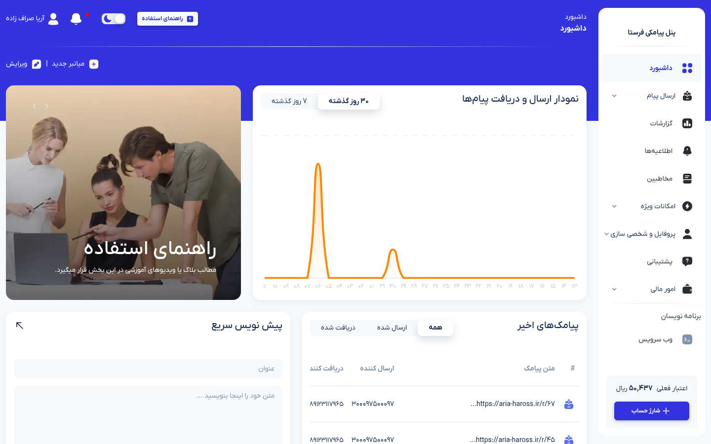
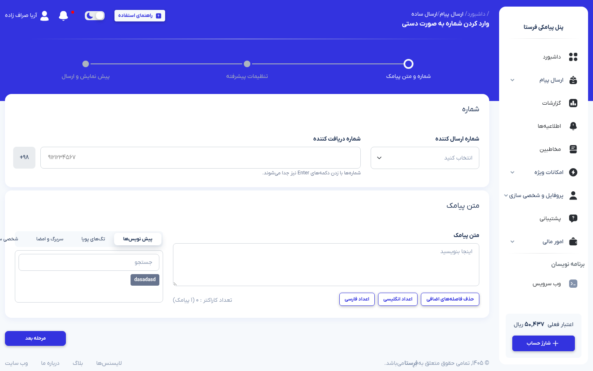
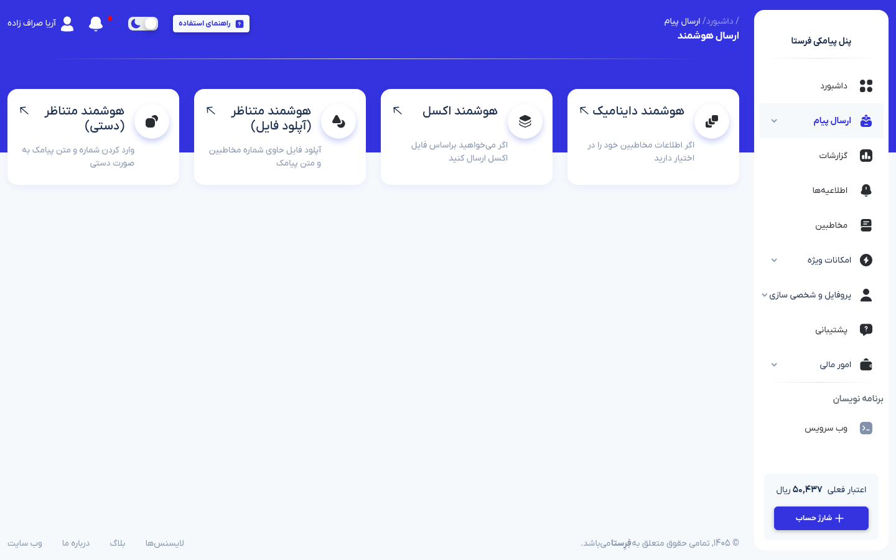
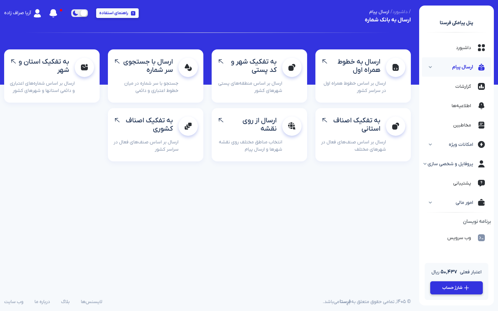
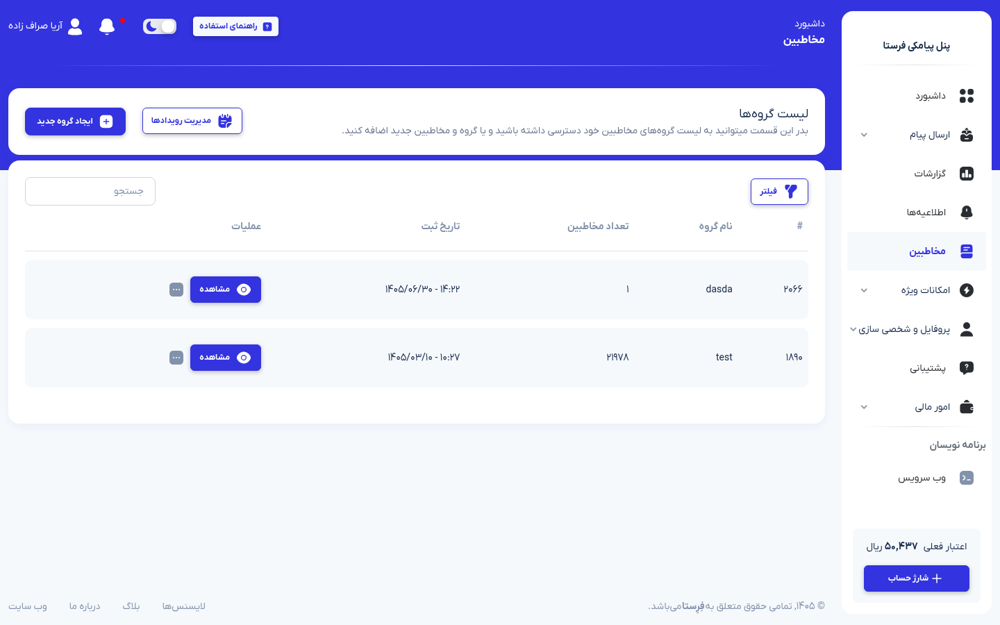
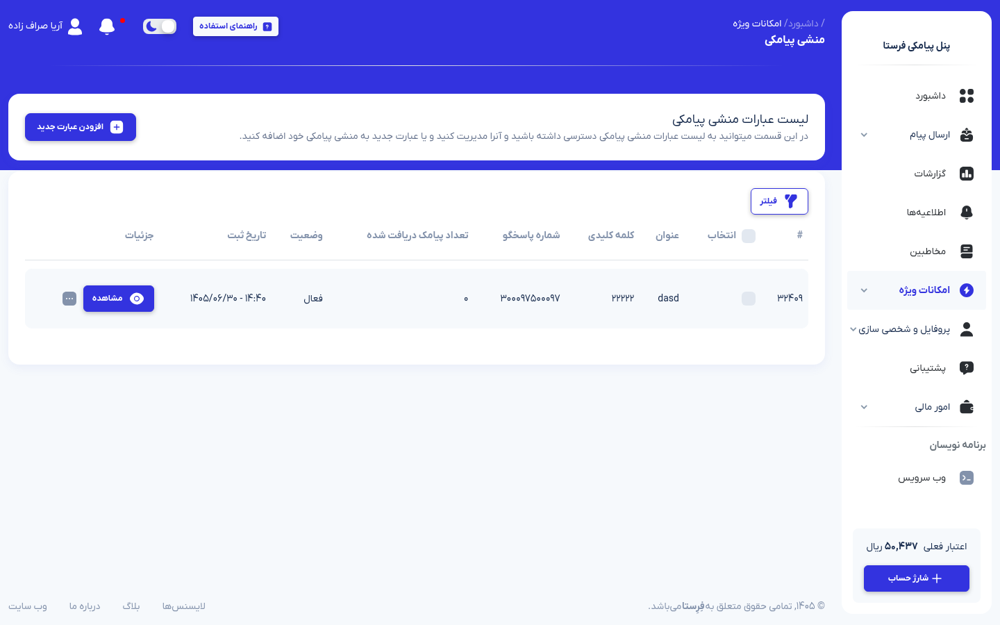
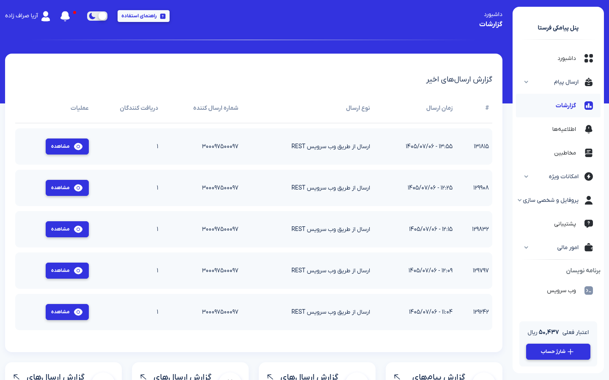
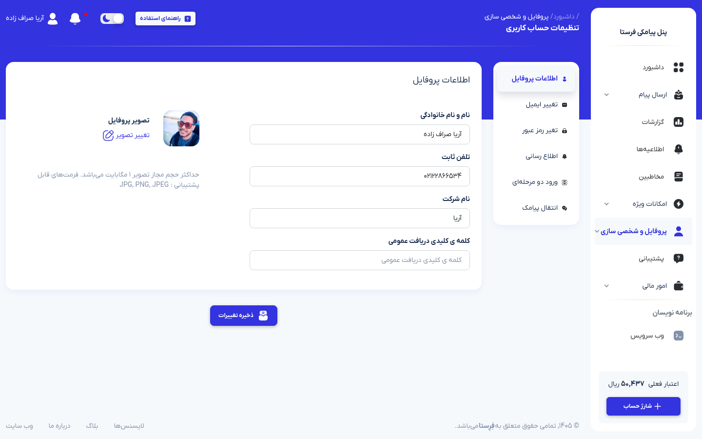

# راهنمای جامع و کاربردی سامانه پیام کوتاه فِرِستا (PersiaFava)

> **سامانه پیام کوتاه فِرِستا (فرستا، رسا در رسانه)**  
> **آدرس ورود به پنل:** [https://panel.persiafava.com](https://panel.persiafava.com)  
> **پشتیبانی و امور مشترکین:** [سامانه تیکتینگ درون پنل کاربری](https://panel.persiafava.com/dashboard/support)  

---

## فهرست سرفصل‌ها
- [۱. مقدمه و شروع سریع](#۱-مقدمه-و-شروع-سریع)
- [۲. ثبت‌نام، ورود امن، کپچا و احراز هویت](#۲-ثبتنام-ورود-امن-کپچا-و-احراز-هویت)
  - [الف) ثبت‌نام در سامانه](#الف-ثبتنام-در-سامانه)
  - [ب) ورود امن به پنل و کد امنیتی (Captcha)](#ب-ورود-امن-به-پنل-و-کد-امنیتی-captcha)
  - [ج) مراحل سه‌گانه احراز هویت قانونی](#ج-مراحل-سهگانه-احراز-هویت-قانونی)
  - [د) مشخصات من و اطلاعات حساب کاربری](#د-مشخصات-من-و-اطلاعات-حساب-کاربری)
- [۳. داشبورد مدیریتی و شاخص‌های آماری](#۳-داشبورد-مدیریتی-و-شاخصهای-آماری)
  - [اجزای اصلی داشبورد](#اجزای-اصلی-داشبورد)
- [۴. راهنمای جامع ماژول ارسال پیامک](#۴-راهنمای-جامع-ماژول-ارسال-پیامک)
  - [قوانین و استانداردهای عمومی ارسال پیامک](#قوانین-و-استانداردهای-عمومی-ارسال-پیامک)
  - [۱. ارسال ساده (Simple Send)](#۱-ارسال-ساده-simple-send)
  - [۲. ارسال هوشمند (Smart Send)](#۲-ارسال-هوشمند-smart-send)
  - [۳. ارسال به بانک شماره کشوری و منطقه‌ای (Bank Send)](#۳-ارسال-به-بانک-شماره-کشوری-و-منطقهای-bank-send)
    - [ارسال به خطوط همراه اول به تفکیک استان و شهر](#ارسال-به-خطوط-همراه-اول-به-تفکیک-استان-و-شهر)
    - [ارسال به تفکیک شهر و کد پستی](#ارسال-به-تفکیک-شهر-و-کد-پستی)
    - [ارسال با جستجوی سرشماره](#ارسال-با-جستجوی-سرشماره)
    - [ارسال به تفکیک استان و شهر کلی](#ارسال-به-تفکیک-استان-و-شهر-کلی)
    - [بانک اصناف استانی و کشوری و ارسال از روی نقشه (BTS)](#بانک-اصناف-استانی-و-کشوری-و-ارسال-از-روی-نقشه-bts)
  - [۴. مدیریت پیش‌نویس‌های پیامک (Drafts)](#۴-مدیریت-پیشنویسهای-پیامک-drafts)
- [۵. ماژول الگوهای پیامکی (Templates)](#۵-ماژول-الگوهای-پیامکی-templates)
  - [ساختار و کاربرد الگوها](#ساختار-و-کاربرد-الگوها)
  - [تعریف متغیرها در الگو با ساختار %name%](#تعریف-متغیرها-در-الگو-با-ساختار-name)
  - [مراحل ثبت و ایجاد الگوی جدید](#مراحل-ثبت-و-ایجاد-الگوی-جدید)
- [۶. دفترچه تلفن و مدیریت مخاطبین](#۶-دفترچه-تلفن-و-مدیریت-مخاطبین)
  - [مدیریت گروه‌ها](#مدیریت-گروهها)
  - [۵ شیوه افزودن مخاطب به سامانه](#۵-شیوه-افزودن-مخاطب-به-سامانه)
  - [عملیات و امکانات روی مخاطبین پس از ایجاد](#عملیات-و-امکانات-روی-مخاطبین-پس-از-ایجاد)
  - [مدیریت رویدادها و مناسبت‌های هوشمند](#مدیریت-رویدادها-و-مناسبتهای-هوشمند)
- [۷. امکانات ویژه و ارزش‌افزوده](#۷-امکانات-ویژه-و-ارزشافزوده)
  - [منشی پیامکی هوشمند (SMS Assist)](#منشی-پیامکی-هوشمند-sms-assist)
  - [مسابقه، قرعه‌کشی و کدخوان، نوبت‌دهی، نظرسنجی و تحلیلگر](#مسابقه-قرعهکشی-و-کدخوان-نوبتدهی-نظرسنجی-و-تحلیلگر)
- [۸. گزارش‌ها، صندوق پیام‌ها و پیگیری وضعیت تحویل](#۸-گزارشها-صندوق-پیامها-و-پیگیری-وضعیت-تحویل)
  - [انواع گزارش‌ها و پیگیری وضعیت](#انواع-گزارشها-و-پیگیری-وضعیت)
  - [صندوق پیام‌ها و اطلاعیه‌های سامانه](#صندوق-پیامها-و-اطلاعیههای-سامانه)
- [۹. پروفایل، خطوط اختصاصی، امنیت و شخصی‌سازی](#۹-پروفایل-خطوط-اختصاصی-امنیت-و-شخصیسازی)
  - [تنظیمات پروفایل و امنیت ورود](#تنظیمات-پروفایل-و-امنیت-ورود)
  - [لیست خطوط اختصاصی](#لیست-خطوط-اختصاصی)
  - [گزارش نشست‌ها و لاگ ورود کاربر](#گزارش-نشستها-و-لاگ-ورود-کاربر)
  - [شخصی‌سازی پیشرفته پیام‌ها، سربرگ و امضا](#شخصیسازی-پیشرفته-پیامها-سربرگ-و-امضا)
  - [انتقال پیامک و وب‌هوک (SMS Forwarding & Webhook)](#انتقال-پیامک-و-وبهوک-sms-forwarding--webhook)
- [۱۰. تنظیمات و لاگ وب‌سرویس (برای برنامه‌نویسان)](#۱۰-تنظیمات-و-لاگ-وبسرویس-برای-برنامهنویسان)
  - [تنظیمات وب‌سرویس، کلید API و IPهای مجاز](#تنظیمات-وبسرویس-کلید-api-و-ipهای-مجاز)
  - [بررسی لاگ وب‌سرویس](#بررسی-لاگ-وبسرویس)
- [۱۱. امور مالی، افزایش اعتبار و تراکنش‌ها](#۱۱-امور-مالی-افزایش-اعتبار-و-تراکنشها)
  - [شارژ آنلاین حساب و محاسبات مالیاتی قانون بودجه](#شارژ-آنلاین-حساب-و-محاسبات-مالیاتی-قانون-بودجه)
  - [ثبت فیش بانکی (واریز کارت به کارت، پایا، ساتنا)](#ثبت-فیش-بانکی-واریز-کارت-به-کارت-پایا-ساتنا)
  - [تاریخچه جامع تراکنش‌ها و فیلترهای مالی](#تاریخچه-جامع-تراکنشها-و-فیلترهای-مالی)
- [۱۲. مرکز پشتیبانی و تیکتینگ](#۱۲-مرکز-پشتیبانی-و-تیکتینگ)

---

## ۱. مقدمه و شروع سریع

سامانه پیام کوتاه **فِرِستا**، زیرساختی مدرن، سریع و یکپارچه برای مدیریت ارتباطات پیامکی سازمانی، تبلیغاتی و خدماتی است. این سامانه با اتصال مستقیم به درگاه‌های معتبر اپراتوری (همراه اول، ایرانسل، رایتل و اپراتورهای ثابت) بستری پایدار جهت ارسال پیامک‌های اطلاع‌رسانی، کدهای احراز هویت، کمپین‌های تبلیغاتی منطقه‌ای و پاسخگویی خودکار به مشتریان فراهم می‌آورد.

---

## ۲. ثبت‌نام، ورود امن، کپچا و احراز هویت

### الف) ثبت‌نام در سامانه
برای ایجاد حساب کاربری جدید به آدرس [صفحه ثبت‌نام](https://panel.persiafava.com/register) مراجعه نمایید و مشخصات زیر را تکمیل کنید:
- **نام کاربری (Username):** شناسه ورود یکتا با حداقل ۳ کاراکتر انگلیسی یا عددی.
- **رمز عبور و تکرار آن:** کلمه عبور ایمن شامل ترکیب حروف بزرگ، کوچک و ارقام.
- **نام و نام خانوادگی:** نام کامل دارنده حساب منطبق با مدارک شناسایی.
- **شماره همراه:** شماره فعال بدون فاصله جهت دریافت کدهای تایید و پیام‌های امنیتی.
- **پست الکترونیکی:** ایمیل معتبر برای مکاتبات و بازیابی کلمه عبور.
- **پکیج کاربری:** انتخاب بسته متناسب با برآورد حجم ارسال و تعرفه دلخواه.

### ب) ورود امن به پنل و کد امنیتی (Captcha)
- **آدرس مستقیم ورود:** [https://panel.persiafava.com/login](https://panel.persiafava.com/login)
- در فرم ورود، پس از درج «نام کاربری» و «کلمه عبور»، تکمیل تصویر کد امنیتی (کپچا) الزامی است. این مکانیزم برای جلوگیری از حملات Brute-Force و بات‌های مخرب تعبیه شده است. در صورت ناخوانا بودن کد امنیتی، با کلیک روی آیکون بازنشانی کنار تصویر، کد جدیدی دریافت کنید.

### ج) مراحل سه‌گانه احراز هویت قانونی
- **آدرس مستقیم در پنل:** [https://panel.persiafava.com/dashboard/profile/verify](https://panel.persiafava.com/dashboard/profile/verify)
طبق مقررات سازمان تنظیم مقررات و ارتباطات رادیویی، تخصیص خط و ارسال پیامک منوط به احراز هویت است. این فرایند شامل سه مرحله است:
1. **اطلاعات شخصی (حقیقی):**
   - نام و نام خانوادگی، جنسیت (زن/مرد).
   - نوع مدرک شناسایی (کارت ملی، گذرنامه، کارت آمایش، کارت پناهندگی، کارت هویت).
   - شماره مدرک شناسایی، تابعیت، تاریخ تولد (روز، ماه، سال)، نام پدر، شماره شناسنامه و محل تولد.
   - اطلاعات تماس: شماره همراه، تلفن ثابت، ایمیل، استان، شهر، کد پستی و آدرس دقیق پستی.
2. **اطلاعات حقوقی (ویژه شرکت‌ها و موسسات):**
   - نام شرکت، شناسه ملی، شماره ثبت، تاریخ ثبت، کد اقتصادی، روزنامه رسمی و نام مدیرعامل و صاحبان امضا.
3. **ارسال مدارک:**
   - بارگذاری تصویر واضح کارت ملی (رو و پشت) یا معرفی‌نامه حقوقی و تصویر قبض یا تاییدیه کد پستی.

### د) مشخصات من و اطلاعات حساب کاربری
- **آدرس مستقیم در پنل:** [https://panel.persiafava.com/dashboard/profile/my-info](https://panel.persiafava.com/dashboard/profile/my-info)
در این بخش امکان بازبینی وضعیت تایید مدارک، مشخصات فردی، مشخصات شرکت و نشانی ثبت‌شده وجود دارد.

---

## ۳. داشبورد مدیریتی و شاخص‌های آماری
- **آدرس مستقیم در پنل:** [https://panel.persiafava.com/dashboard](https://panel.persiafava.com/dashboard)

### اجزای اصلی داشبورد:
1. **نوار بالایی (Top Header):** دسترسی سریع به راهنما، تغییر تم تاریک و روشن، مشاهده اطلاعیه‌ها در [پیام‌های سامانه](https://panel.persiafava.com/dashboard/messages) و مدیریت پروفایل.
2. **نمایش آنلاین اعتبار ریالی (Sidebar Bottom):** مشاهده لحظه‌ای مانده حساب با امکان ورود مستقیم به [صفحه شارژ حساب](https://panel.persiafava.com/dashboard/financial/charge).
3. **نمودار ترافیک ارسال و دریافت:** نمایش تحلیلی و آماری عملکرد پیامک‌ها در دوره‌های ۷ روزه و ۳۰ روزه گذشته با فیلتر تفکیکی (همه، ارسال شده، دریافت شده).
4. **جدول آخرین پیامک‌ها:** فهرست پیام‌های اخیر به همراه متن، سرشماره ارسال‌کننده، گیرنده، ساعت ارسال و وضعیت دلیوری.
5. **شمارنده‌های شاخص وضعیت:**
   - **پیش‌نویس سریع:** یادداشت و ذخیره پیام‌های آماده.
   - **در صف تایید:** پیام‌های ارسالی در انتظار بازبینی محتوایی اپراتور.
   - **ارسال شده:** پیامک‌های مخابره‌شده به شبکه ارتباطی.
   - **ارسال در آینده:** پیام‌های زمان‌بندی‌شده برای تاریخ‌های بعد.
   - **لیست سیاه (Blacklist):** شماره‌هایی که پیامک تبلیغاتی خط خود را مسدود کرده‌اند.

---

## ۴. راهنمای جامع ماژول ارسال پیامک

### قوانین و استانداردهای عمومی ارسال پیامک

#### ۱. فرمت استاندارد شماره‌های گیرنده در سامانه فرستا
- کلیه شماره‌های تلفن همراه مقصد باید دقیقاً در قالب **۱۰ رقمی بدون صفر اول و بدون پیش‌شماره کشور** وارد شوند (مانند `9121234567`).
- شماره‌های معتبر: تمام پیش‌شماره‌های فعال کشور از جمله اپراتورهای همراه اول (`091`، `099`)، ایرانسل (`093`، `090`، `094`)، رایتل (`092`) و تالیا.
- شماره‌های بین‌المللی: در صورت فعال بودن بسته بین‌الملل، با کد کشور و بدون علامت مثبت درج گردند.

#### ۲. قواعد شمارش کاراکتر و صفحات پیامک
- **پیامک فارسی:**
  - صفحه اول: حداکثر تا ۷۰ کاراکتر.
  - صفحات بعد (پیامک متصل/Concatenated): هر صفحه معادل ۶۷ کاراکتر محاسبه می‌شود.
- **پیامک انگلیسی (GSM):**
  - صفحه اول: حداکثر تا ۱۶۰ کاراکتر.
  - صفحات بعد: هر صفحه معادل ۱۵۳ کاراکتر محاسبه می‌شود.
- **توجه به کاراکترهای ویژه:** کلید Enter (شکست خط)، کاراکترهای اعراب‌گذاری، گیومه و برخی اموجی‌ها ممکن است معادل دو یا چند کاراکتر استاندارد GSM در نظر گرفته شوند.

#### ۳. ابزارهای کمکی ویرایش متن
- **حذف فاصله‌های اضافه:** پیرایش نیم‌فاصله‌ها و اسپیس‌های زائد برای جلوگیری از افزایش ناخواسته صفحات پیامک.
- **تبدیل ارقام:** دکمه‌های تبدیل ارقام به «اعداد فارسی» یا «اعداد انگلیسی» جهت یکدستی متون صورتحساب یا کدها.
- **شخصی‌سازی پیشرفته:** درج سریع برچسب‌های داینامیک نام، پیشوند جنسیت، سربرگ و امضا با یک کلیک.

---

### ۱. ارسال ساده (Simple Send)
- **آدرس مستقیم در پنل:** [https://panel.persiafava.com/dashboard/send/simple](https://panel.persiafava.com/dashboard/send/simple)

ارسال ساده مناسب مواردی است که یک متن یکسان برای یک یا چند گیرنده ارسال می‌شود:

#### روش‌های سه‌گانه ورود شماره در ارسال ساده:
1. **روش الف: وارد کردن شماره به صورت دستی:**
   - تایپ مستقیم شماره‌های ۱۰ رقمی در کادر مربوطه.
   - برای درج چند شماره، از کلید Enter، ویرگول یا خط جدید استفاده کنید.
2. **روش ب: ارسال از لیست مخاطبین:**
   - انتخاب دکمه «مخاطبین» و علامت زدن یک یا چند گروه از پیش ساخته‌شده در دفترچه تلفن.
3. **روش ج: ارسال از طریق آپلود فایل:**
   - بارگذاری فایل‌های متنی (`.txt`) یا فایل اکسل (`.xlsx`, `.xls`, `.csv`) حاوی شماره تلفن گیرندگان.
   - سامانه به طور خودکار ستون شماره‌ها را شناسایی کرده و شماره‌های تکراری یا نامعتبر را پیش از ارسال حذف می‌نماید.

#### تنظیمات زمان ارسال:
- **ارسال آنی:** ارسال بلافاصله پس از فشردن دکمه تایید.
- **ارسال زمان‌بندی‌شده:** تعیین تاریخ شمسی و ساعت مشخص جهت مخابره خودکار در موعد مقرر.

---

### ۲. ارسال هوشمند (Smart Send)
- **آدرس مستقیم در پنل:** [https://panel.persiafava.com/dashboard/send/smart](https://panel.persiafava.com/dashboard/send/smart)

ارسال هوشمند برای کمپین‌هایی به کار می‌رود که هر پیامک دارای اطلاعات اختصاصی متغیر (مانند نام مشتری، مبلغ بدهی، شماره فاکتور یا کد رهگیری) برای هر شخص است.

#### شیوه‌های چهارگانه ارسال هوشمند:
1. **هوشمند داینامیک:** استفاده از ستون‌های اطلاعاتی مخاطبین دفترچه تلفن (نام، نام خانوادگی، پسوند، شماره پرونده).
2. **هوشمند اکسل:** آپلود فایل اکسل دلخواه؛ با انتخاب ستون‌ها به عنوان متغیر (مانند `ستون ۱`، `ستون ۲`) متن هر سطر به صورت داینامیک پر می‌شود.
3. **هوشمند متناظر آپلود فایل:** بارگذاری فایلی که در هر سطر آن یک شماره و در مقابل آن متن اختصاصی همان شماره درج شده است.
4. **هوشمند متناظر دستی:** ورود دستی زوج‌های «شماره گیرنده + متن پیامک اختصاصی» در محیط جدول درون پنل.

---

### ۳. ارسال به بانک شماره کشوری و منطقه‌ای (Bank Send)
- **آدرس مستقیم در پنل:** [https://panel.persiafava.com/dashboard/send/bank](https://panel.persiafava.com/dashboard/send/bank)

بانک شماره کشوری فرستا امکان دسترسی به میلیون‌ها مشترک تلفن همراه را بدون نیاز به جمع‌آوری شماره شخصی فراهم می‌کند:

#### روش‌های ارسال از طریق بانک شماره:
1. **ارسال به خطوط همراه اول به تفکیک استان و شهر:**
   - مسیر پنل: [https://panel.persiafava.com/dashboard/send/bank/mci](https://panel.persiafava.com/dashboard/send/bank/mci)
   - انتخاب استان، سپس شهر و تفکیک خطوط اعتباری یا دائمی با تعیین تعداد گیرندگان تصادفی یا ترتیبی.
2. **ارسال به تفکیک شهر و کد پستی:**
   - مسیر پنل: [https://panel.persiafava.com/dashboard/send/bank/postal-code](https://panel.persiafava.com/dashboard/send/bank/postal-code)
   - ورود ۳ تا ۵ رقم اول کد پستی منطقه مورد نظر جهت هدف‌گیری دقیق محله‌های شهری.
3. **ارسال با جستجوی سرشماره:**
   - مسیر پنل: [https://panel.persiafava.com/dashboard/send/bank/prefix](https://panel.persiafava.com/dashboard/send/bank/prefix)
   - ارسال به رنج‌های مشخص خطوط (مانند پیش‌شماره‌های خاص یا سیم‌کارت‌های جدید یک منطقه).
4. **ارسال به تفکیک استان و شهر کلی:**
   - مسیر پنل: [https://panel.persiafava.com/dashboard/send/bank/province](https://panel.persiafava.com/dashboard/send/bank/province)
   - انتخاب تقسیمات کشوری برای هر دو اپراتور همراه اول و ایرانسل.
5. **بانک اصناف استانی و کشوری و ارسال از روی نقشه (BTS):**
   - انتخاب مشاغل تخصصی (پزشکان، مهندسان، وکلا، فروشگاه‌داران و...) یا انتخاب محدوده جغرافیایی از روی نقشه دکل‌های مخابراتی.

---

### ۴. مدیریت پیش‌نویس‌های پیامک (Drafts)
- **آدرس مستقیم در پنل:** [https://panel.persiafava.com/dashboard/send/draft](https://panel.persiafava.com/dashboard/send/draft)

امکان ایجاد و ویرایش پیام‌های پرتکرار (مانند پیامک خوش‌آمدگویی، اعلام ساعات کاری، آدرس شعب، شماره کارت یا شبای بانکی). در تمامی فرم‌های ارسال ساده، هوشمند و منشی، دسترسی فوری به پیش‌نویس‌ها با یک کلیک فراهم است.

---

## ۵. ماژول الگوهای پیامکی (Templates)
- **آدرس مستقیم در پنل:** [https://panel.persiafava.com/dashboard/templates](https://panel.persiafava.com/dashboard/templates)
- **فرم ثبت الگوی جدید:** [https://panel.persiafava.com/dashboard/templates/create](https://panel.persiafava.com/dashboard/templates/create)

الگوهای پیامکی برای ساخت قالب‌های استاندارد پیامک‌های سریع و خدماتی با قابلیت تایید سرشماره و متن مشخص طراحی شده‌اند:

### قوانین تعریف متغیر در الگوها:
- **ساختار متغیر:** برای تعریف متغیر، آن را بین دو کاراکتر درصد قرار دهید: `%name%`.
- **قانون الزامی:** متن هر الگوی پیامکی باید حداقل شامل یک متغیر با ساختار `%name%` باشد (مانند: `کد تایید ورود شما: %code%`).

### فیلدهای فرم ایجاد الگو:
1. **عنوان الگوی پیامکی:** نام انتخابی برای شناسایی و دسته‌بندی سریع‌تر الگو (مثلاً: `کد ورود` یا `یادآوری بدهی`).
2. **انتخاب سرشماره برای ارسال:** تعیین خط اختصاصی یا اشتراکی مورد نظر جهت مخابره این الگو.
3. **متن الگوی پیامکی:** بدنه متن به همراه متغیرها؛ با امکان پیش‌نمایش در قاب موبایل، حذف فاصله‌های اضافه، تغییر فونت ارقام، و درج تگ‌های پویا.
4. دکمه **«ذخیره کردن»** جهت ثبت الگو.

---

## ۶. دفترچه تلفن و مدیریت مخاطبین
- **آدرس مستقیم در پنل:** [https://panel.persiafava.com/dashboard/groups](https://panel.persiafava.com/dashboard/groups)

### مدیریت گروه‌ها
- **ایجاد گروه جدید:** ساخت گروه‌بندی‌های اختصاصی (مانند مشتریان ویژه، نمایندگان، پرسنل).
- **فهرست گروه‌ها:** شامل شناسه یکتا، نام، تعداد اعضا، تاریخ ثبت، مشاهده اعضا، ویرایش نام یا حذف گروه.

### ۵ شیوه افزودن مخاطب به سامانه:
1. **وارد کردن به صورت تکی (`/create/single`):** ثبت نام، نام خانوادگی، شماره موبایل ۱۰ رقمی و یادداشت.
2. **آپلود فایل (`/create/file`):** بارگذاری فایل‌های اکسل یا متنی با انطباق ستون‌ها.
3. **انتقال از گروه‌های دیگر (`/create/move`):** کپی یا جابجایی دسته‌ای مخاطبین میان گروه‌ها.
4. **وارد کردن به صورت رنجی (`/create/range`):** تولید خودکار بازه عددی متوالی شماره‌ها.
5. **وارد کردن دستی دسته‌ای (`/create/manual`):** درج انبوه شماره‌ها در کادر متنی با تفکیک خط.

### عملیات و امکانات روی مخاطبین پس از ایجاد:
- ویرایش اطلاعات، حذف تکی یا گروهی، انتقال به لیست سیاه، و خروجی اکسل کامل.
- ثبت مناسبت‌های هوشمند (تاریخ تولد، سالگرد ازدواج، سررسید تمدید بیمه یا قرارداد) با امکان ارسال خودکار تبریک و یادآوری.

---

## ۷. امکانات ویژه و ارزش‌افزوده

### منشی پیامکی هوشمند (SMS Assist)
- **آدرس مستقیم در پنل:** [https://panel.persiafava.com/dashboard/specials/sms-assist](https://panel.persiafava.com/dashboard/specials/sms-assist)

منشی پیامکی، خط اختصاصی شما را به سامانه‌ای هوشمند برای پاسخگویی ۲۴ ساعته تبدیل می‌کند.

#### مراحل ساخت منشی:
1. **تعیین کلیدواژه:** تعریف کلمه یا عدد مشخص (مانند `کاتالوگ` یا `1`).
2. **متن پاسخ خودکار:** متنی که بلافاصله پس از دریافت پیامک مشتری ارسال می‌شود.
3. **تنظیمات تکمیلی:** افزودن خودکار شماره مشتری به گروه مشخصی در دفترچه تلفن و تعیین ساعت و روزهای فعالیت.

### مسابقه، قرعه‌کشی و کدخوان، نوبت‌دهی، نظرسنجی و تحلیلگر
ماژول‌های تعاملی ارزش افزوده شامل:
- **مسابقه پیامکی (`/specials/competition`):** طراحی سوالات چندگزینه‌ای و امتیازدهی خودکار.
- **قرعه‌کشی و کدخوان (`/specials/lottery`):** اعتبارسنجی بن تخفیف و شماره سریال گارانتی.
- **نوبت‌دهی (`/specials/turns`):** زمان‌بندی خودکار جلسات، ویزیت پزشکان یا خدمات.
- **نظرسنجی (`/specials/polls`):** دریافت امتیازات و آمار تحلیلی رضایت مشتریان.
- **تحلیلگر (`/specials/analysis`):** ارزیابی نرخ بازگشت و کارایی کمپین‌های پیامکی.

---

## ۸. گزارش‌ها، صندوق پیام‌ها و پیگیری وضعیت تحویل

### انواع گزارش‌ها و پیگیری وضعیت
- **آدرس مستقیم در پنل:** [https://panel.persiafava.com/dashboard/reports](https://panel.persiafava.com/dashboard/reports)

1. **گزارش ارسال‌های اخیر:** نمایش آخرین بسته‌های ارسالی با جزئیات خط، زمان، هزینه و تعداد گیرندگان.
2. **پیام‌های دریافتی (Inbox):** صندوق ورودی پیامک‌های مشتریان با امکان پاسخ مستقیم.
3. **پیام‌های زمان‌بندی‌شده:** تقویم پیام‌های آینده با قابلیت بازبینی یا لغو پیش از موعد ارسال.
4. **خروجی جامع اکسل و وضعیت دلیوری:**
   - **رسیده به گوشی (Delivered):** پیام با موفقیت روی دستگاه مخاطب تحویل شده است.
   - **رسیده به مخابرات (Sent to Telco):** پیامک در صف اپراتور جهت تحویل قرار دارد.
   - **لیست سیاه (Blacklist):** مشترک دریافت پیامک تبلیغاتی را مسدود کرده و هزینه آن طبق ضوابط به اعتبار کاربر بازمی‌گردد.
   - **ارسال ناموفق / خاموش:** عدم دسترسی به خط یا خاموش بودن دستگاه مشترک.

### صندوق پیام‌ها و اطلاعیه‌های سامانه
- **آدرس مستقیم در پنل:** [https://panel.persiafava.com/dashboard/messages](https://panel.persiafava.com/dashboard/messages)
مشاهده پیام‌ها و بیانیه‌های مهم مدیریت پنل، اطلاعیه‌های سراسری قطعی یا نگهداری اپراتورها، و تغییرات پروتکل‌های ارتباطی با قابلیت جستجو و مشاهده متن پیام.

---

## ۹. پروفایل، خطوط اختصاصی، امنیت و شخصی‌سازی

### تنظیمات پروفایل و امنیت ورود
- **آدرس مستقیم در پنل:** [https://panel.persiafava.com/dashboard/profile/setting](https://panel.persiafava.com/dashboard/profile/setting)

- **ویرایش مشخصات:** اطلاعات تماس، نام تجاری، کلمه کلیدی دریافت عمومی و تصویر نمایه.
- **تغییر رمز عبور:** به‌روزرسانی منظم کلمه عبور با رعایت الزامات امنیتی.
- **ورود دو مرحله‌ای (2FA):** افزایش ضریب ایمنی ورود با کد تایید پیامکی.
- **تنظیم هشدارها:** ارسال پیامک در هنگام افت اعتبار از سقف تعیین‌شده یا ورود با آی‌پی جدید.

### لیست خطوط اختصاصی
- **آدرس مستقیم در پنل:** [https://panel.persiafava.com/dashboard/profile/private-lines](https://panel.persiafava.com/dashboard/profile/private-lines)
مشاهده و فیلتر خطوط پیامکی اختصاص‌یافته به حساب کاربری به همراه جزئیات شماره، درگاه ارسال، درگاه دلیوری، وضعیت احراز هویت، تاریخ ثبت و تاریخ انقضا.

### گزارش نشست‌ها و لاگ ورود کاربر
- **آدرس مستقیم در پنل:** [https://panel.persiafava.com/dashboard/profile/login-report](https://panel.persiafava.com/dashboard/profile/login-report)
جدول مانیتورینگ امنیتی ورودهای کاربر شامل ردیف، آدرس IP، نوع و نسخه مرورگر، وضعیت ورود (موفق/ناموفق) و تاریخ و ساعت دقیق ثبت.

### شخصی‌سازی پیشرفته پیام‌ها، سربرگ و امضا
- **آدرس مستقیم در پنل:** [https://panel.persiafava.com/dashboard/profile/message-customization](https://panel.persiafava.com/dashboard/profile/message-customization)
1. **پیشوندهای جنسیت:** تعیین عنوان پیش‌فرض مرد فارسی (`جناب آقای`)، مرد لاتین (`jenabe aghaye`)، زن فارسی (`سرکار خانم`) و زن لاتین (`sarkar khanome`).
2. **سربرگ و امضای سرتاسری:** درج خودکار متن ثابت در ابتدا یا انتهای تمامی پیامک‌های خروجی.
3. **قالب‌های پیش‌فرض هوشمند:** فعال‌سازی الگوهای تخصصی اصناف.

### انتقال پیامک و وب‌هوک (SMS Forwarding & Webhook)
- **انتقال به موبایل (SMS Forwarding):** هدایت آنی پیامک‌های دریافتی از مشتریان به شماره تلفن مدیر.
- **وب‌هوک (Webhook URL):** فراخوانی آدرس URL سرور شما با متد HTTP POST جهت دریافت خودکار اطلاعات پیام‌های ورودی در سیستم‌های CRM و حسابداری داخلی.

---

## ۱۰. تنظیمات و لاگ وب‌سرویس (برای برنامه‌نویسان)

### تنظیمات وب‌سرویس، کلید API و IPهای مجاز
- **آدرس مستقیم در پنل:** [https://panel.persiafava.com/dashboard/setting/web-service](https://panel.persiafava.com/dashboard/setting/web-service)
1. **کلید وب‌سرویس (API Key):** کلید محرمانه اختصاصی جهت احراز هویت درخواست‌های RESTful.
2. **آی‌پی‌های مجاز (IP Whitelist):** درج آی‌پی‌های سرور فرستنده در خطوط تفکیک‌شده؛ در صورت خالی بودن، درخواست‌ها از کلیه آی‌پی‌ها پذیرفته می‌شوند.
3. **آدرس بازگشت وب‌هوک (Send to URL):** تعیین URL اختصاصی دریافت رویدادها و وضعیت پیام‌ها.

### بررسی لاگ وب‌سرویس
- **آدرس مستقیم در پنل:** [https://panel.persiafava.com/dashboard/webservices/log](https://panel.persiafava.com/dashboard/webservices/log)
ثبت سابقه کلیه فراخوانی‌های وب‌سرویس، خطاهای اعتبارسنجی، کدهای پاسخ HTTP و بررسی عملکرد نرم‌افزارهای متصل به سامانه.

---

## ۱۱. امور مالی، افزایش اعتبار و تراکنش‌ها

### شارژ آنلاین حساب و محاسبات مالیاتی قانون بودجه
- **آدرس مستقیم در پنل:** [https://panel.persiafava.com/dashboard/financial/charge](https://panel.persiafava.com/dashboard/financial/charge)
1. ورود مبلغ دلخواه شارژ بر حسب ریال.
2. محاسبه شفاف اقلام قانونی شامل:
   - عوارض بند «ی» تبصره ۶ قانون بودجه کل کشور.
   - مالیات بر ارزش افزوده قانونی.
   - مبلغ کل قابل پرداخت.
3. انتخاب درگاه پرداخت شاپرک (زرین‌پال، نکست‌پی و درگاه‌های بانکی) و دریافت آنی اعتبار و پیش‌رسید.

### ثبت فیش بانکی (واریز کارت به کارت، پایا، ساتنا)
- **آدرس مستقیم در پنل:** [https://panel.persiafava.com/dashboard/financial/register-slip](https://panel.persiafava.com/dashboard/financial/register-slip)
جهت شارژ حساب از طریق حواله‌های بین بانکی یا دستگاه خودپرداز:
1. انتخاب شماره حساب مقصد واریز (مانند حساب بانک رفاه شرکت).
2. درج شماره فیش یا کد پیگیری واریز.
3. ثبت مبلغ واریزشده (به ریال) و تاریخ دقیق انتقال وجه.
4. نوشتن توضیحات تکمیلی و بارگذاری فایل تصویر فیش پرداختی.
5. کلیک روی «ثبت فیش» جهت بررسی و تایید کارشناسان مالی.

### تاریخچه جامع تراکنش‌ها و فیلترهای مالی
- **آدرس مستقیم در پنل:** [https://panel.persiafava.com/dashboard/financial/history](https://panel.persiafava.com/dashboard/financial/history)
گزارش کامل تراکنش‌های مالی حساب شامل فیلتر بر اساس نوع تراکنش (شارژ، کسر هزینه کمپین، بازگشت هزینه بلک‌لیست)، بازه زمانی تاریخ و ساعت از/تا، تعداد نتایج در صفحه، و جستجو در شرح تراکنش‌ها.

---

## ۱۲. مرکز پشتیبانی و تیکتینگ
- **آدرس مستقیم در پنل:** [https://panel.persiafava.com/dashboard/support](https://panel.persiafava.com/dashboard/support)

در صورت نیاز به مشاوره فنی، ارتقای خطوط، استعلام خدماتی‌سازی شماره یا پیگیری تراکنش‌ها:
1. در [صفحه پشتیبانی](https://panel.persiafava.com/dashboard/support) بر روی دکمه **«ایجاد تیکت جدید»** کلیک کنید.
2. دپارتمان مربوطه (پشتیبانی فنی، امور مالی یا فروش) و سطح فوریت تیکت را انتخاب فرمایید.
3. موضوع تیکت و شرح کامل درخواست را وارد کرده و در صورت نیاز اسکرین‌شات یا فایل مستند ضمیمه کنید.
4. پاسخ کارشناسان به صورت آنلاین در همین صفحه قابل رهگیری بوده و همزمان پیامک اطلاع‌رسانی ارسال می‌گردد.
